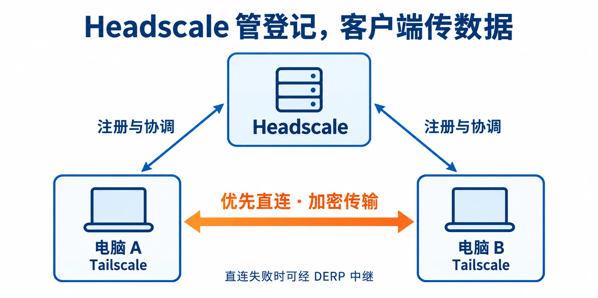
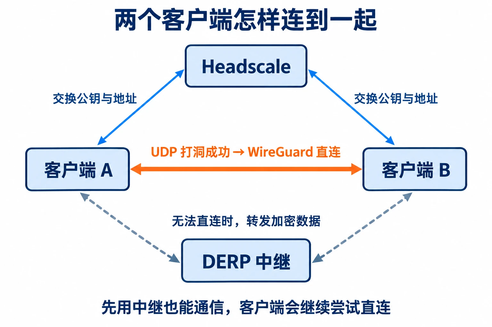
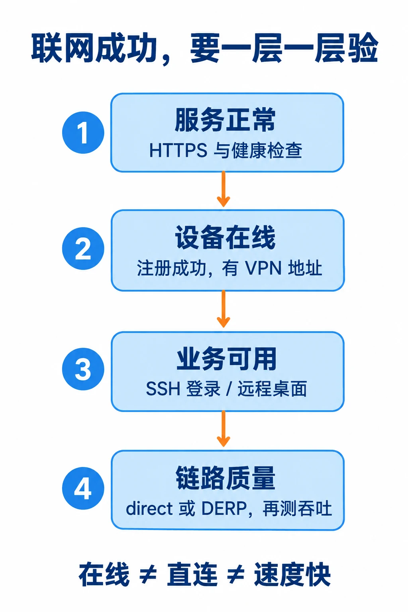
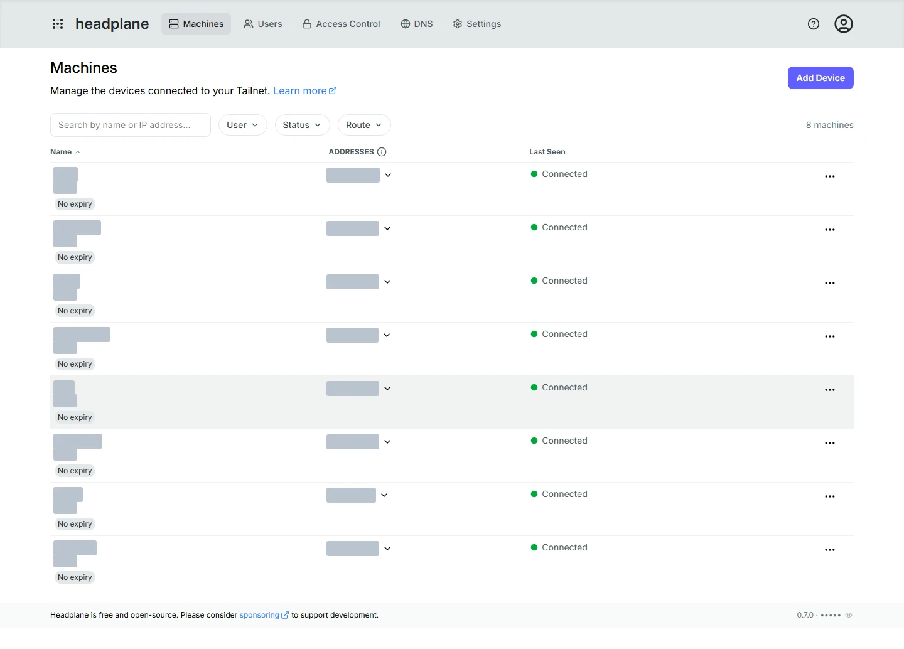

# 让电脑和服务器像在同一个局域网里一样通信：Headscale 自建实录


Tailscale 最方便的地方，就是能把不同地方的电脑和服务器连到一起，像在同一个局域网里一样互相访问。

比如人在外面，想远程连接家里的电脑；或者在自己的笔记本上，访问办公室的 Linux、虚拟机和云服务器。以前可能要申请公网 IP、设置端口转发，碰到多层路由还得继续折腾。用了 Tailscale，给设备装上客户端，加入同一个网络，用分配的私有 IP 就能访问了。

SSH、远程桌面、服务器上的网页服务，都可以这样连接。我有几台云服务器，本地还有 Proxmox 和虚拟机，放到一个网络里以后，确实省事。

但用远程桌面的时候，光能连接还不够。延迟高了，鼠标点下去要等，窗口拖起来不跟手，连上了也不好用。

这时候可以考虑自己部署 Headscale。

## 把 Tailscale 的控制服务放到自己的服务器上

Headscale 可以理解为一个能私有部署的 Tailscale 控制服务。你可以把它装到自己的国内云服务器上，设备注册和网络管理就不用依赖 Tailscale 官方控制服务了。

电脑上还是用官方 Tailscale 客户端，不用换软件，只需要把登录服务器改成自己的地址。

如果连接需要走中继，还可以配上国内 DERP 中继，减少不合适的中继线路带来的绕路。这也是我这次自建想解决的问题：设备自己管理，远程连接尽量走合适的线路。

说明白一点：两台设备能直连时，数据本来就不经过官方服务器；需要中继时，才更需要考虑中继的位置。**所以自建以后，还是要看能不能直连，不能只凭换了服务器就认定一定更快。**



这张图里，Headscale 负责让设备认识彼此，真正传文件、连接远程桌面的，还是两端的客户端。

## 两个客户端登录以后，是怎么直连的

比如家里的电脑 A，要连接云服务器 B。两边都登录 Headscale 以后，并不是把所有数据先发到 Headscale，再由它转给对方。

**Headscale 帮两台机器交换连接信息，客户端自己想办法连到一起。** 可以分成下面几步看。

第一步，登记设备。A、B 向 Headscale 注册，各自获得一个 VPN IP。Headscale 按访问策略，把对方的公钥、可尝试连接的地址等信息发给客户端。私钥留在各自设备上。

第二步，找地址。客户端会收集自己的内网地址，还会通过 STUN 探测路由器映射出来的公网 IP 和 UDP 端口。同一个局域网里的设备，可以尝试走内网；隔着互联网，就尝试公网端点。

第三步，尝试 UDP 打洞。A、B 都向对方的地址发包，让各自路由器和防火墙建立允许回包的记录。如果网络条件允许，两边就能互相收到数据，建立 WireGuard 加密直连。“打洞”不是把路由器永久开一个口子，而是利用这些临时的映射和连接状态。



如果路由器或防火墙限制比较严格，直连暂时建立不起来，客户端就可以经 DERP 中继通信。它们也可以先通过中继连上，再继续尝试直连，成功后切换过去。中继转发的是加密数据，不能解密里面的内容。图中的三条路径，是不同职责和连接方式，不是要求每份数据依次走一遍。

这时再看 VPN IP，就比较好理解了。比如 B 的地址是 `100.64.0.10`，你在 A 上运行：

```bash
ssh youruser@100.64.0.10
```

Tailscale 会识别这个目标，把 SSH 流量加密后发给 B。你使用的是相对固定的 VPN 地址，底下真正传输时用的，是客户端找到的实际网络地址和端口；换了 Wi-Fi，客户端会重新发现可用路径。

所以我们不用每次都跟着对方的公网地址变化，重新修改 SSH 或远程桌面地址。直连能不能建立，则取决于两端网络。一端是有可达 UDP 端口的云服务器时，通常会容易一些。

想进一步了解 UDP 打洞，可以看 [Tailscale 对 NAT 穿透的解释](https://tailscale.com/blog/how-nat-traversal-works)。平时使用时，运行 `tailscale ping 对方的VPN地址`，看当前是直连还是 DERP 就行。

## 准备一台云服务器和一个域名

我这次直接用了已有的 Linux 云服务器，没有重新买机器。服务器上还跑着其他服务，所以只增加 Headscale 和管理后台，原来的业务继续运行。

自己部署，需要准备这几样：

- 一台有公网 IP 的 Linux 云服务器，能通过 SSH 登录。
- 一个自己能管理解析的域名。
- 电脑和其他设备上的官方 Tailscale 客户端。

比如给它分配一个子域名：

```text
vpn.example.com
```

在域名后台添加 A 记录，把 `vpn` 指向云服务器的公网 IP。先直接解析到服务器，不叠加 CDN，部署和排错都简单一些。

端口也要放行。云服务器的安全组和系统防火墙都检查一下：

| 端口 | 用来做什么 |
|---|---|
| TCP 443 | HTTPS 连接入口 |
| TCP 80 | HTTP 跳转或证书验证，按证书方案需要开放 |
| UDP 3478 | 开启内嵌 DERP/STUN 时使用 |
| UDP 41641 | 云服务器自身也安装 Tailscale、加入网络时按需开放 |

这里我就踩了一个很简单的坑：端口号填对了，协议选成了 TCP。看着已经放行，UDP 还是不通。后面改成正确的 UDP 规则，再测就正常了。

我这次用的是 Headscale 0.29.5，配套 Tailscale 1.104.1，管理后台是 Headplane 0.7.0。你安装时让 Codex 检查一下当前版本的兼容关系，不要把不同年份的配置混着用。

## 服务端怎么部署

大致就是这几步：安装 Headscale，配置域名和 HTTPS，启用国内中继，再把客户端加进来。想用网页管理设备，就另外装一个 Headplane 后台。

Headscale 本身没有完整的设备管理网页。刚装完点开域名，没看到熟悉的后台，不一定是装错了。我也是后来加了 Headplane，才有了设备列表和用户管理。

在 Debian、Ubuntu 上，可以从 [Headscale 官方安装文档](https://headscale.net/stable/setup/install/official/)下载对应架构的软件包。安装后，主要配置文件在：

```text
/etc/headscale/config.yaml
```

把对外地址设置成自己的域名，由 Nginx 或 OpenResty 提供 HTTPS，Headscale 在本机监听。下面只列关键字段，其他部分沿用对应版本的完整示例配置：

```yaml
server_url: https://vpn.example.com
listen_addr: 127.0.0.1:8088
```

启用服务后看看状态：

```bash
sudo systemctl enable --now headscale
sudo systemctl status headscale --no-pager
```

再从外部访问健康检查地址：

```bash
curl -fsS https://vpn.example.com/health
```

服务器原来就有网站的话，让 Codex 复用现有反向代理，别把其他网站的配置覆盖掉。HTTPS 证书顺便配好自动续期，免得过几个月突然连不上，又要重新排查。

我这里没有把整份配置贴出来。不同版本的字段会变，国内中继还需要填写自己的公网地址。照着官方配置，再让 Codex 根据服务器现状调整，比复制一份不知道哪年写的配置省心。

## 电脑怎么连上去

客户端还是从 [Tailscale 官网](https://tailscale.com/download)下载安装。

Windows 打开 PowerShell，运行：

```powershell
tailscale login --login-server=https://vpn.example.com
```

Linux 则运行：

```bash
sudo tailscale up \
  --login-server=https://vpn.example.com \
  --accept-dns=false \
  --accept-routes=false
```

后面这两个参数，是先保留原来的 DNS 和路由安排。我这次只是想让机器互相访问，先不把其他网络也接进来。

执行后，按照注册页面的提示，在服务器端批准设备，分配到自己的用户下面。也可以在后台创建一次性接入密钥，用来添加服务器。

如果用命令行管理，先创建一个用户：

```bash
sudo headscale users create alice
sudo headscale users list
```

具体注册命令按当前页面提示执行。[官方入门文档](https://headscale.net/stable/usage/getting-started/)也有完整流程。

接入后，客户端会得到一个 VPN 地址。比如目标 Linux 的地址是 `100.64.0.10`，以后就可以这样连接：

```bash
ssh youruser@100.64.0.10
```

连接 Windows 远程桌面，也是在远程桌面客户端里填写目标电脑的 VPN 地址，再输入那台 Windows 的账号密码。

目标电脑要先开启远程桌面。如果希望 Windows 退出登录后还能远程连接，在 Tailscale 设置里打开 **Run unattended**。

## 连上以后，看看是不是直连

客户端运行：

```bash
tailscale status
tailscale ping 100.64.0.10
```

地址换成你自己的设备地址。看输出是直连端点，还是 `DERP` 中继。

我这次新增接入了六台服务器，实际 SSH 都能登录。当次测试中，五台建立了直连，另一台还是通过国内中继连接。能正常使用，但线路还不一样。



如果远程桌面还是卡，就继续查直连和中继线路，再看带宽、丢包以及目标电脑的负载。想知道传文件有多快，可以另外测吞吐，别拿一个 ping 延迟当成传输速度。

还有两个地方，自己部署时容易漏掉。

**一个是 Clash。** 我电脑上开着全局托管和 TUN，流量可能先被代理接走。只写一条 DIRECT 规则还不够，要检查 TUN 的路由排除，把自己的控制服务器地址和实际使用的 VPN 网段处理好。别直接照抄别人的地址。

**另一个是多人使用。** Headscale 可以有多个用户，但后台给了一个管理角色，不等于这个账号就只能管理自己的设备。我这次就遇到过新账号能看到其他用户设备的问题，后来加了服务端的归属限制。自己一个人用可以先只保留管理员账号；要分享给朋友，先把权限范围测清楚。

## 想自己装，直接把这段发给 Codex

服务器和域名准备好后，把下面这段交给 Codex 就可以。SSH 入口、密钥位置和域名另外告诉它，别把密码、私钥贴到公开地方。

```text
帮我在指定的 Linux 云服务器上部署 Headscale，用来连接我的电脑、
本地虚拟机和云服务器。服务器 SSH 入口和域名由我另外提供。

先检查现有服务和端口占用，备份相关配置，不影响原来的业务。
选择相互兼容的 Headscale、Tailscale 和 Headplane 版本。

配置域名解析、HTTPS、证书自动续期、开机启动，
按需要启用国内 DERP/STUN，并检查云安全组和系统防火墙。
注意 TCP 和 UDP 不要选错。

客户端继续使用官方 Tailscale，登录到我自己的 Headscale。
先不接管 DNS、不接收子网路由、不设置出口节点。
如果电脑上有 Clash 或其他 TUN 代理，检查路由是否冲突。

部署 Headplane 网页后台，用账号密码登录，关闭公开注册。
先只供管理员使用；如果需要其他用户管理自己的设备，
确认服务端权限确实做了限制，再开放账号。

最后把指定设备接进来，通过 VPN 地址实际测试 SSH，
检查 direct/DERP 状态，远程桌面按需要实际登录测试。
告诉我后台地址、客户端连接命令，以及出现问题时怎么恢复。
密码和密钥只保存在受保护的位置，不提交到 Git 或公开日志。
```

## 部署后的后台是什么样

下面是我部署后的 Headplane 设备页。当时八台设备都显示在线，设备名、账号和地址已经遮挡。



对我来说，这套东西最实用的地方，就是电脑和服务器终于可以按同一种方式连接了。在外面用笔记本，连本地虚拟机或者云服务器，不用再分别去找它们的公网映射端口。

如果你也有几台分散在不同地方的机器，可以先用官方 Tailscale。需要自己管理控制服务，或者想配国内中继，再考虑 Headscale。

文中域名、IP 和用户名均为示例，配图中的后台信息已脱敏。
