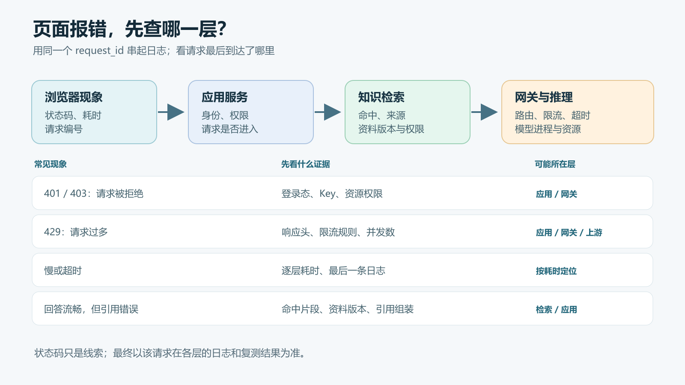

# FDE 新人手册 01：一个 AI 请求到底经过了哪些系统

用户问了一句“这台设备为什么频繁停机”，页面转了半天，最后只显示“请求失败”。

这时最没用的一句话是：“模型是不是坏了？”模型可能根本没收到请求。也可能模型回答得很快，慢的是前面的知识检索。要排查，先得知道这句话实际走过了哪些系统。

下面用一个企业维修助手做例子。它接收用户提问，从维修手册和历史工单中找资料，再让大模型组织回答。真实项目的组件可以合并，也可以拆得更细，但每一层负责的事大致相同。


## 一条请求，先后经过什么

**1. 客户端。** 用户在网页输入问题，浏览器把问题、登录状态和当前会话标识发给应用服务。浏览器负责展示回答，不应该直接持有模型服务的长期密钥。

**2. 应用服务。** 这里先确认“谁在问、能看什么”，再决定要不要查知识库、调用哪个模型、回答采用什么格式。很多项目把这部分叫业务后端或编排层。它也是整条链路的总调度：负责把各处结果拼起来，最终回给浏览器。

**3. 知识检索。** 如果问题需要企业内部资料，应用服务会拿问题去检索。检索服务可能先把问题转换成向量，再从索引中找相关片段，也可能同时使用关键词检索。它返回的是**候选资料及其来源**，不是最终答案。没有找到资料、找错资料、拿到了用户无权查看的资料，都是这一段要检查的问题。

**4. 模型网关。** 应用服务把问题和允许使用的资料组成请求，交给网关。网关通常负责鉴权、路由、限流、超时与调用记录。它回答的是“这个请求能不能进、该送到哪个模型服务”，不负责保证模型说得对。

**5. 推理服务。** 这一步才真正加载模型并生成文本。推理服务可能跑在本地 CPU、GPU 服务器或云端。它关心模型能否加载、显存是否够、生成速度如何、并发时会不会排队。模型生成的文本沿原路返回，应用服务再检查、整理并展示给用户。

所以，“调用模型成功”和“用户得到正确答案”是两件事。HTTP 返回 200，只能说明某个接口正常返回；引用是否正确、权限是否守住、答案是否解决问题，还要另外验证。

## 纯聊天与 RAG，差别在哪里

如果只是普通聊天，可以把链路简化成：**浏览器 → 应用服务 → 模型网关 → 推理服务 → 浏览器**。

如果要回答“公司最新版设备保养规程怎么写”，就多了一条检索支路。模型本身并不会因为公司上传了一份新文件，就自动知道文件内容。应用服务需要先取回有权限的相关片段，再随问题一起交给模型。这个过程常被叫作 RAG。

举个直接的判断：回答里写着“每 80 小时更换桨叶”，但引用的还是旧版“每 100 小时”的规程。模型服务可能运行正常，问题却出在资料更新、索引或引用组装。盯着 GPU 利用率查半天，方向就偏了。

## 新人排错，先找请求停在哪一层

最实用的办法，是给一次请求一个贯穿全链路的 `request_id`（也常叫 `trace_id`）。浏览器、应用、检索、网关和模型服务都记录同一个编号。日志里不要写明文密钥，也不要把完整的客户资料原样打出来。

下面是**示意日志，不是某个真实系统的实测结果**：

```text
request_id=demo-042 app       auth=ok          elapsed_ms=12
request_id=demo-042 retrieval hits=0           elapsed_ms=34
request_id=demo-042 gateway   route=model-small elapsed_ms=4
request_id=demo-042 inference status=200        elapsed_ms=930
request_id=demo-042 app       status=200         elapsed_ms=995
```

这次请求没有接口错误，但检索命中数为零。如果用户问的是企业内部规程，下一步应先看资料是否入库、索引是否更新、权限过滤是否过严，而不是立刻换模型。



可以按这个顺序看：

| 看到的现象 | 优先检查 | 不要直接下的结论 |
| --- | --- | --- |
| 浏览器报 401 或 403 | 登录状态、应用服务鉴权、资源权限 | “模型拒绝回答” |
| 很快返回 429 | 应用或网关的限流、配额、并发设置 | “模型算力不够” |
| 一直转圈，最终超时 | 同一个请求编号在各层的耗时和最后一条日志 | “肯定是模型慢” |
| 回答流畅但引用不对 | 检索命中、资料版本、引用组装 | “模型 API 有故障” |
| 偶发 5xx | 报错发生在哪一层、进程重启、资源用量和上游错误 | “重试成功就算修好” |

这些只是排查入口，不是错误码与原因的一一对应表。比如 429 可以由应用、网关或上游服务返回；要结合响应头、日志和请求编号判断。

## 最少留下四类证据

刚接手系统时，不必先研究所有框架源码。拿一个测试问题，把下面四件事查明白：

1. **入口证据：** 请求从哪个地址进入？用户身份在哪里校验？
2. **链路证据：** 同一个 `request_id` 能否从应用追到检索、网关和推理服务？
3. **结果证据：** 返回了什么状态码、用了多久、检索到哪些来源、最终引用了哪份资料？
4. **反例证据：** 换成无权限账号，是否真的看不到受限资料？查不到依据时，系统会不会坦白说不知道？

如果这四件事说不清，系统即使能演示一段漂亮回答，出了问题也很难修。下一篇再动手：拿到一台服务器，先检查哪些条件，才能判断模型服务跑不跑得起来。
