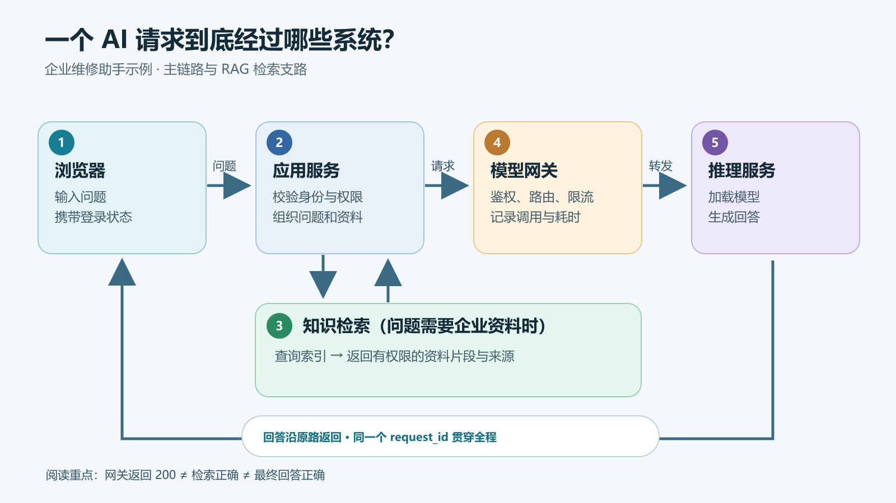

# FDE前线部署工程师小白书 02：一个 AI 请求到底经过了哪些系统

> 本文属于 [FDE前线部署工程师小白书](/series/fde/)。如果还不清楚岗位负责什么，可以先读[第 01 篇：FDE 到底是什么](/posts/2026/10/13/what-is-fde/)。

用户问了一句“这台设备为什么频繁停机”，页面转了半天，最后只显示“请求失败”。

这时最没用的一句话是：“模型是不是坏了？”模型可能根本没收到请求。也可能模型回答得很快，慢的是前面的知识检索。要排查，先得知道这句话实际走过了哪些系统。

下面用一个企业维修助手做例子。它接收用户提问，从维修手册和历史工单中找资料，再让大模型组织回答。读完这篇，你至少应该能做两件事：画出自己项目里的一条真实请求链路；页面出错时，知道先去哪一层找证据。

图里的结构是教学用的简化结构，不是要求所有项目都部署五套独立软件。有的产品把应用和检索做在一个进程里，有的网关由云服务提供。**先分清职责，再看它们实际部署在哪里**，比背一张产品架构图有用。

## 一条请求，先后经过什么

### 01 · 客户端

用户在网页输入问题，浏览器把问题、登录状态和当前会话标识发给应用服务。浏览器负责展示回答，不应该直接持有模型服务的长期密钥。浏览器的网络面板还能告诉你：请求有没有发出去、发到了哪个地址、返回了什么状态码、等了多久。这些是排错的第一手信息，别只盯着页面上的“请求失败”四个字。

### 02 · 应用服务

这里先确认“谁在问、能看什么”，再决定要不要查知识库、调用哪个模型、回答采用什么格式。很多项目把这部分叫业务后端或编排层。它也是整条链路的总调度：负责把各处结果拼起来，最终回给浏览器。比如维修员工能查设备手册，访客却不能查内部故障记录，这个身份和权限信息不能在进入检索之后凭空消失。

### 03 · 知识检索

如果问题需要企业内部资料，应用服务会拿问题去检索。检索服务可能先把问题转换成向量，再从索引中找相关片段，也可能同时使用关键词检索。它返回的是**候选资料及其来源**，不是最终答案。片段至少应能追到原文件、版本和访问范围。没有找到资料、找错资料、拿到了用户无权查看的资料，都是这一段要检查的问题。

### 04 · 模型网关

应用服务把问题和允许使用的资料组成请求，交给网关。网关通常负责鉴权、路由、限流、超时与调用记录。应用里填的模型名，可能只是网关中的一个逻辑名称，实际被转发到哪台机器、哪个模型版本，要看当时的路由配置和调用日志。网关回答的是“这个请求能不能进、该送到哪个模型服务”，不负责保证模型说得对。

### 05 · 推理服务

这一步才真正加载模型并生成文本。推理服务可能跑在本地 CPU、GPU 服务器或云端。它关心模型能否加载、显存是否够、生成速度如何、并发时会不会排队。即使同一个模型，请求的输入长度、输出长度和同时在线的人数变了，耗时也会变。模型生成的文本沿原路返回，应用服务再检查、整理并展示给用户。

> **一句话记住：** 应用决定怎么做，检索找依据，网关把请求送对地方，推理服务生成文字。谁都不能替其他层证明结果正确。

### 跟着一次请求走一遍

假设维修员工问：“A17 设备连续停机，先检查什么？”应用服务收到问题后，先拿到该员工的身份和允许访问的资料范围。检索服务从手册和已授权工单中返回几段内容，应用再把问题、片段和回答要求交给模型。模型写出排查建议，应用把回答、引用来源和请求编号送回网页。

这里有两个容易混淆的“数据”：一类是**运行时请求**，比如用户的问题、会话信息、检索结果；另一类是**建库时的数据**，比如上传手册、清洗文件、建立索引。上传文件成功不等于这次请求检索到了它，检索到了它也不等于模型最终引用了它。要验证，得沿着这三个位置分别看。

一个便于对照日志的简化记录可以长这样。字段和值都是示意，不对应真实平台接口：

  
<strong>示意请求记录</strong><code>request_id=demo-042</code>

  
入口<code>user_role=maintenance</code> 问题：A17 设备连续停机，先检查什么？

  
检索<code>hits=2</code> 来源：手册 v3 / 第 4 节、工单示例 / 17

  
网关<code>route=repair-model</code> <code>upstream_status=200</code>

  
返回引用：手册 v3 / 第 4 节 <code>app_status=200</code>

这四行解决的问题很实际：前端说“答错了”，你可以先确认检索有没有找对文件，再确认正确片段有没有被送进模型，最后看应用展示的引用是不是同一份资料。

## 纯聊天与 RAG，差别在哪里

如果只是普通聊天，可以把链路简化成：**浏览器 → 应用服务 → 模型网关 → 推理服务 → 浏览器**。系统提示词、历史对话和用户问题通常由应用组装后发给模型。它能回答常识问题，但对公司刚更新的内部制度，模型没有天然的实时知情能力。

如果要回答“公司最新版设备保养规程怎么写”，就多了一条检索支路。模型本身并不会因为公司上传了一份新文件，就自动知道文件内容。应用服务需要先取回有权限的相关片段，再随问题一起交给模型。这个过程常被叫作 RAG。这里的关键不是“接上一个向量库”这么简单，而是**哪份资料被取回来、能否给这个用户看、回答能否指回原文**。

举个直接的判断：回答里写着“每 80 小时更换桨叶”，但引用的还是旧版“每 100 小时”的规程。模型服务可能运行正常，问题却出在资料更新、索引或引用组装。盯着 GPU 利用率查半天，方向就偏了。

还有一种情况：检索结果正确，模型却把“每 80 小时检查一次”说成“每 80 小时更换一次”。这时需要看送给模型的片段和提示要求，再检查最终生成内容。改索引未必能解决这个问题。**检索正确、生成正确、引用正确，是三道不同的检查。**

## 为什么页面一直转圈，模型却可能早就开始回答了

很多聊天页面采用流式输出：模型生成一小段，服务就向前端发送一小段。用户看到文字逐步出现。为了实现它，推理服务、网关、应用和浏览器之间都得正确转发数据流。

假设推理服务在 1 秒后生成第一个字，但应用层把完整回答攒齐才返回，用户仍会看到页面转圈。如果反向代理缓冲了流，现象也很像。此时只查“模型总共用了几秒”，很容易误判。

排这种问题，至少分开看三个时间：**入口收到请求的时间、首段内容到达应用的时间、浏览器看到首段内容的时间**。前两个相差很大，查模型、网关或上游网络；后两个相差很大，查应用转发、代理缓冲和前端读取。总耗时只是最终数字，告诉不了你时间花在哪儿。

流式接口还有一个细节：页面已经收到 HTTP 200，不代表后续数据一定完整。连接可能在生成中途断掉。因此要记录“开始流式返回”和“正常结束或异常中断”两个事件，不能只记一个 200。

## 新人排错，先找请求停在哪一层

最实用的办法，是给一次请求一个贯穿全链路的 `request_id`（也常叫 `trace_id`）。一般由可信的入口或应用服务生成，再传给下游；如果浏览器传入编号，服务端也需要校验或重新生成，别让任意输入污染日志。浏览器、应用、检索、网关和模型服务都记录同一个编号。日志里不要写明文密钥，也不要把完整的客户资料原样打出来。

定位时，我会先打开浏览器开发者工具的“网络”面板，找到那条失败请求，记下 URL、状态码、耗时以及响应中的请求编号。接着到应用日志里找同一个编号，看它有没有调用检索和网关；再到下游找。哪一层收到了、哪一层没收到，范围就缩小了。

如果项目没有统一编号，至少先记录请求发生的时间、接口路径、测试账号和一个不会暴露敏感信息的测试问题，然后推动各层加上编号。靠“差不多下午三点那次请求”去几十万行日志里碰运气，新人老手都得头疼。

下面是**示意日志，不是某个真实系统的实测结果**：

  
<strong>逐层耗时</strong><code>request_id=demo-042</code>

  
应用鉴权<code>auth=ok</code><strong class="fde-trace__time"><code>elapsed_ms=12</code></strong>

  
知识检索<code>hits=0</code><strong class="fde-trace__time"><code>elapsed_ms=34</code></strong>

  
模型网关<code>route=model-small</code><strong class="fde-trace__time"><code>elapsed_ms=4</code></strong>

  
推理服务<code>status=200</code><strong class="fde-trace__time"><code>elapsed_ms=930</code></strong>

  
应用返回<code>status=200</code><strong class="fde-trace__time"><code>elapsed_ms=995</code>（总耗时）</strong>

这次请求没有接口错误，但检索命中数为零。如果用户问的是企业内部规程，下一步应先看资料是否入库、索引是否更新、权限过滤是否过严，而不是立刻换模型。日志里的耗时也有用：推理服务用掉了大部分时间；如果页面却是在收到模型结果后又卡了很久，还得继续查应用返回和浏览器渲染。

可以按这个顺序看：

  
<strong>浏览器报 401 或 403</strong>先查登录状态、应用鉴权、资源权限<small>别急着说“模型拒绝回答”</small>

  
<strong>很快返回 429</strong>先查应用或网关的限流、配额、并发设置<small>别急着说“模型算力不够”</small>

  
<strong>一直转圈，最终超时</strong>按请求编号比对各层耗时和最后一条日志<small>别急着说“肯定是模型慢”</small>

  
<strong>回答流畅，但引用不对</strong>先查检索命中、资料版本、引用组装<small>别急着说“模型 API 有故障”</small>

  
<strong>偶发 5xx</strong>先查报错层、进程重启、资源用量和上游错误<small>别把“重试成功”当作修好</small>

这些只是排查入口，不是错误码与原因的一一对应表。比如 429 可以由应用、网关或上游服务返回；要结合响应头、日志和请求编号判断。

### 以“页面转圈最后超时”为例

先别重启服务。拿到请求编号后，依次确认：

1. **浏览器到应用：** 网络面板里请求是否真正发出？如果一直处于等待，记下等待了多少秒；如果浏览器根本没发出请求，先看前端逻辑和本机网络。
2. **应用到检索：** 应用日志里是否开始检索、是否结束、命中多少条？如果卡在这里，优先查检索服务状态、索引和数据库连接。
3. **应用到网关：** 是否发起模型请求？网关返回了什么状态，路由到哪个上游？如果网关限流或找不到上游，推理服务的 GPU 指标再漂亮也无济于事。
4. **网关到推理：** 推理服务有没有收到请求？有没有排队、内存不足或进程重启？先看服务日志和资源，再判断是否需要调参数或扩容。
5. **返回浏览器：** 模型已经完成时，应用是否正常转发？代理是否缓冲？流中途有没有断？这一步常被一句“后端已经 200”草草带过。

每查完一层，只做与证据对应的调整，然后用**同一个测试问题、同一个账号**复测。不要同时改模型、网关和索引；否则问题即使消失，也说不清是哪一项起了作用。

## “接口成功”和“答案可用”分开验

新手最容易被一个绿色的 200 迷惑。实际上至少有三层结果：

  
<strong>01 · 服务可调用</strong>请求到达上游，正常返回或结束流<small>200 只能证明接口层面成功</small>

  
<strong>02 · 资料可用</strong>命中正确版本、来源可追溯；无权账号查不到<small>200 不能证明</small>

  
<strong>03 · 回答可用</strong>结论与资料一致，引用对应原文；无依据时不乱答<small>200 不能证明</small>

有时系统返回的状态码是 200，但正文写着“上游模型不可用”，这是应用做了错误兜底；也可能请求因为超时返回 504，而推理服务后来完成了生成。处理这类情况，要把**用户看到的结果、应用的记录和下游的记录**放在一起看，不能只截一张响应截图。

## 最少留下四类证据

刚接手系统时，不必先研究所有框架源码。拿一个测试问题，把下面四件事查明白：

1. **入口证据：** 请求从哪个地址进入？用户身份在哪里校验？
2. **链路证据：** 同一个 `request_id` 能否从应用追到检索、网关和推理服务？
3. **结果证据：** 返回了什么状态码、用了多久、检索到哪些来源、最终引用了哪份资料？
4. **反例证据：** 换成无权限账号，是否真的看不到受限资料？查不到依据时，系统会不会坦白说不知道？

如果这四件事说不清，系统即使能演示一段漂亮回答，出了问题也很难修。下一篇再动手：拿到一台服务器，先检查哪些条件，才能判断模型服务跑不跑得起来。
