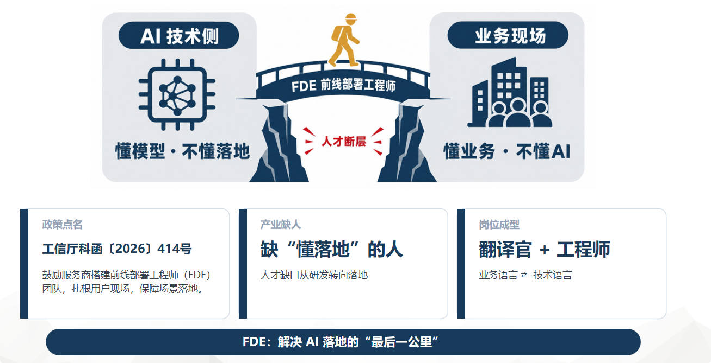
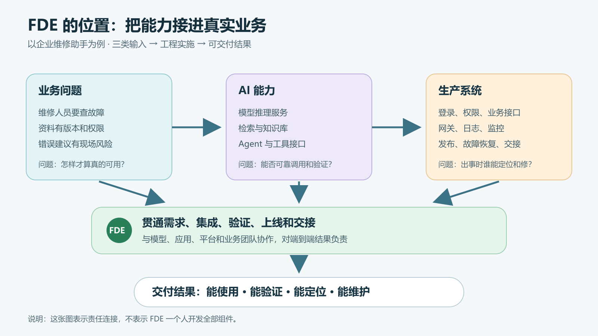
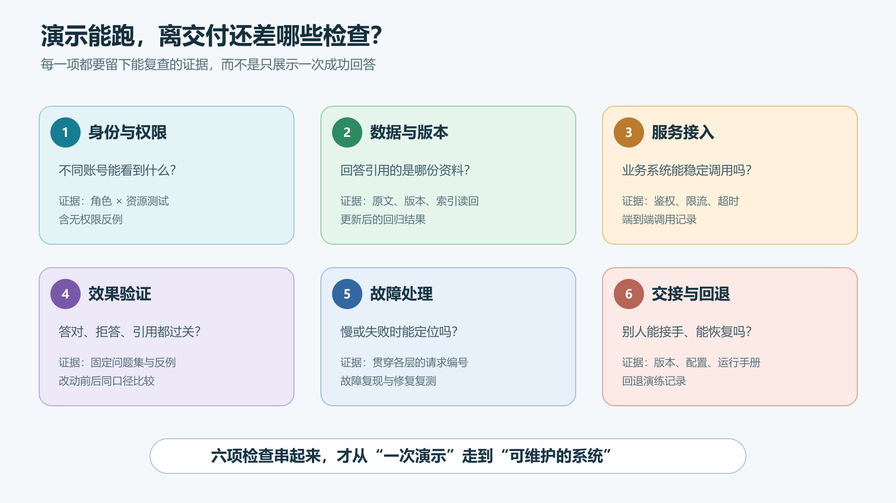

# FDE前线部署工程师小白书 01：FDE 到底是什么

> 本文属于 [FDE前线部署工程师小白书](/series/fde/)：从真实请求链路、部署与排错入手，写给刚接触 FDE 的工程师。

一个 AI 助手在演示会上回答得很好，接进公司的系统之后却不太好用：员工登录不上，内部资料查不到，换个账号又能看到不该看的内容；偶尔转圈半分钟，出了错也不知道该找谁。

模型可能没问题。真正难的是把它放进原有业务里，让它在真实用户、真实权限、真实数据和真实故障下工作。**FDE 做的就是这段工作。**

先把名字说准。业界常见的 FDE 是 **Forward Deployed Engineer**。`Forward` 指靠近客户和实际问题；`Deployed` 也不只是“把程序安装上”。[工信部办公厅的通知](https://www.miit.gov.cn/zwgk/zcwj/wjfb/tz/art/2026/art_6fbc038bf15c445ab53b2a94a3f9d4e4.html)使用的中文名称是**前线部署工程师**；本系列参考的工程实施课程资料使用**前沿部署工程师**。前者突出人在业务前线，后者突出所用的 AI 技术。这两个叫法指向的工作有交集，但引用政策时应使用文件原词。

不同公司对这个岗位的技术深度和分工会有差异，不能只看三个字母就推断它一定在调 GPU，或者一定在客户现场写前端。OpenAI 的 [FDE 岗位说明](https://openai.com/careers/forward-deployed-engineer-%28fde%29-seattle-seattle/)把工作写得很直接：从发现需求、确定范围、设计和构建，到生产上线，并与客户团队一起推进。

下面这张图把 FDE 画成跨越技术侧和业务现场的一座桥。它说中了岗位的一部分，但图上的几句话需要拆开看。

## 图里的“桥”，到底要接通什么

左边“懂模型、不懂落地”，指的是模型能力很强，工程团队也能把 API 跑通，却未必知道企业怎么登录、哪些资料能查、某条维修建议会带来什么现场风险。右边“懂业务、不懂 AI”，指的是业务人员知道故障如何处理，却未必知道模型回答为什么会编造、知识库为什么会引用旧版文件。**断层发生在两边的信息和责任接不上时**，并不意味着技术人员都不懂业务，或业务人员都不懂技术。

“翻译官”先要把业务话翻译成工程上能验证的要求。业务说“让 AI 帮我们排查停机”，FDE 得追问：先查哪类设备？从手册还是历史工单取证？只能给建议，还是允许创建工单？建议由谁确认？成功是节省查询时间，还是减少误判？这些答案决定权限、接口、提示约束和测试用例。

翻译还要反过来。技术团队说“模型支持 128K 上下文”“向量库检索命中率提高了”，业务人员未必知道这对维修流程有什么意义。FDE 要说明：现在能覆盖哪些手册、哪些问题仍应转人工、错答时能否查到原文，以及变更会不会影响原有工单系统。把技术指标对应到具体工作，双方才能对“可用”达成一致。

但**只会沟通还不够**。“工程师”三个字意味着要把方案接入、测通并留下证据：身份权限能否传到检索服务，EAM 接口是否按预期只读，模型网关是否限流，回答能否引用正确版本，服务中断时能否定位与恢复。FDE 可以和模型、应用、平台团队一起做这些事，职责分工由项目决定；不能把“我解释清楚了”当作交付完成。

图中写的工信部文号也能核对。[《关于开展人工智能应用服务商培育专项行动的通知》](https://www.miit.gov.cn/zwgk/zcwj/wjfb/tz/art/2026/art_6fbc038bf15c445ab53b2a94a3f9d4e4.html)的文号是**工信厅科函〔2026〕414号**。文件鼓励服务商搭建前线部署工程师团队，深入用户现场保障场景落地。图里的“人才断层”“最后一公里”“翻译官＋工程师”是帮助理解的比喻，**不是政策原文，也不是政策给 FDE 设定的统一岗位标准**。通知面向应用服务商，不能据此认为已有全国统一的 FDE 个人资格认证。

## FDE 交付的到底是什么

拿“给设备维修人员做一个 AI 助手”举例。最初的需求往往只有一句话：“让员工问设备故障，AI 给出维修建议。”

只做演示，很快：选个模型，上传几份手册，做个聊天框，问一个提前准备的问题，得到一段像样的回答。

但要交付给维修部门使用，问题马上变具体：

- 员工从哪个系统登录？维修人员、客服和访客能看同一批资料吗？
- 手册有旧版和新版，引用哪一版？新文件发布后，旧答案怎么失效？
- 用户问到手册没有写的故障，系统会承认不知道，还是编一个维修步骤？
- 模型服务断了、检索超时了、业务接口返回 429，页面该怎么提示？
- 谁能看请求日志？能否按编号追查一次错误回答，同时不把客户数据和密钥写进日志？
- 上线后怎么评估效果？改了索引或模型配置，怎样知道比原来更好？出了问题能不能退回旧版本？

这些问题横跨业务流程、软件开发、模型服务、数据、权限和运维。FDE 不一定独自实现所有组件，但需要把相关人员和系统接起来，对**端到端结果**负责。这里的“负责”要按团队分工理解：有的 FDE 自己写代码，有的更多做系统集成和技术决策；安全审批、业务终审和正式验收仍由相应负责人完成。

所以，FDE 的产物不是一张“部署成功”的截图，而是一套可运行、可验证、可维护的系统，以及别人接手时看得懂的配置、测试和交接资料。

### 把这个例子真的往前推一步

假设维修部门已经有一套 EAM 系统，里面存着设备台账和工单；文档中心另有维修手册。FDE 接到任务，不该先去挑“最强模型”，而要先把现场弄清楚：EAM 有没有可调用的接口？接口只允许查询还是也能改工单？手册的版本由谁维护？系统部署在内网还是能访问外网？维修建议需要谁确认？

这些问题会直接改变技术方案。如果 EAM 只提供只读接口，助手就可以先做“查询设备记录、整理候选排查步骤”，不用碰自动修改工单。如果手册版本经常变，就需要明确增量更新和旧版本失效规则。如果生产网络不出网，模型、依赖包和知识库组件就要有离线部署办法。方案不是把产品名列成一排，而是把**现场约束写进设计**。

接下来才是把链路接通：员工登录应用；应用带着权限去检索文档或读取 EAM；模型网关把请求送到可用的推理服务；回答附上来源，并保留请求编号供排查。每个连接点都要有一次独立验证。比如 `GET /health` 成功，只说明某个服务还活着；员工账号完成一次带权限的真实查询，才能证明这段业务链路通了。

最后准备固定问题集。既问手册里有明确答案的设备故障，也问查不到依据的问题，还要用无权限账号试一次受限资料。记录改动前后的答案、引用和耗时。若业务负责人发现建议有风险，FDE 要能定位是资料错、检索错、模型生成错，还是页面把结果展示错了，再和相关团队一起改。上线时冻结版本和配置，留下回退办法。这一整段，才接近一次完整的工程交付。

## 从演示到交付，中间具体差什么

下面这张图把差距压缩成六个检查点。它不是认证标准，只是新人接手 AI 项目时很实用的一张对照图。

**一是身份与权限。** 演示时常用同一个管理员账号，正式使用必须知道谁能访问哪个系统、哪份资料。模型回答前，检索就要限定允许看的内容；只在最终答案里删敏感词，已经太晚了。

**二是数据与版本。** 上传文件不等于资料可用。文件可能解析失败、切片不合理、索引没更新、版本标错。回答里的引用要能追到原文和版本，资料更新后还得做回归检查。

**三是服务接入。** 模型在工程师电脑上能跑，不等于公司系统能调用。要有稳定的接口地址、鉴权、超时、限流和调用记录，还要弄清网关究竟把请求送到了哪个模型版本。

**四是效果验证。** 不能拿一两个“问得好”的问题证明系统可用。至少准备一组真实问题和反例：该答的能否答对，没依据的会不会乱答，无权限账号能否看到受限内容，引用是否真的支持结论。

**五是故障处理。** 生产系统一定会遇到超时、上游断连、资源不足和数据异常。关键是能用同一个请求编号查到故障停在哪层，有清楚的降级方式，并在修复后用相同用例复测。

**六是交接与回退。** 当前版本是什么、配置改了什么、依赖哪些外部系统、谁值班、如何恢复旧版，这些必须留下来。只有开发者自己知道怎么修的系统，还没真正交付。

## FDE 和其他工程师怎么分工

岗位名称不是一套严格的行业标准。下面的比较看的是**主要关注点**，不是说谁完全不能做另一列的事。

| 角色 | 主要关注点 | 在维修助手项目中的典型产物 |
| --- | --- | --- |
| 模型或算法工程师 | 模型能力、训练与效果改进 | 模型版本、评测结果、训练或微调产物 |
| AI 应用工程师 | 应用功能、接口和交互 | 问答页面、RAG 流程、业务接口代码 |
| 平台或运维工程师 | 基础设施、发布和稳定运行 | 运行环境、监控、备份与告警 |
| FDE | 把业务问题与上述能力接成可用系统 | 方案取舍、系统集成、联调证据、上线与交接 |

小团队里，一个人可能同时承担两三项职责。FDE 的区别通常不是“会不会写某一种代码”，而是遇到跨系统问题时，不会只说“我的接口是通的”。它需要继续追问：用户最终能否完成工作？如果不能，证据显示卡在哪里？

这也解释了为什么 FDE 得懂一点业务。不是要求工程师替维修专家判断故障，而是要知道“错误建议”可能造成什么后果，哪些动作必须由人确认。比如 AI 可以整理故障记录、给出有出处的候选步骤；真正的维修处置仍要遵守现场流程和人工确认。

## FDE 是不是只有一种

不是。GitHub 上的 [fde-learning 项目](https://github.com/luoboask/fde-learning)将 FDE 分成推理基础设施型、应用部署型和客户交付型，方便读者理解不同工作的侧重点。这只是该项目采用的学习分类，**不是所有公司的统一职级或岗位标准**。看招聘信息或项目分工时，还是要读具体工作内容。

如果团队主要做推理引擎、GPU 利用率、量化和集群调度，岗位会更靠近基础设施。如果主要做 RAG、Agent、评测和业务接口，更靠近应用部署。如果经常进入客户现场，做需求澄清、系统集成、上线和交接，客户交付的比重就更高。

实际项目经常混在一起。比如维修助手既要在内网部署模型，又要连接维修记录系统，还要做带权限的知识库。新人没必要先给自己贴类型标签。先看项目里**哪个问题没人解决，就会导致系统无法交付**，再补对应能力。

## 新人先学什么，才不容易学偏

我会按“先看全链路，再钻一个点”的顺序学。第一步不是读完 Transformer 论文，也不是装遍所有 Agent 框架，而是能回答下面五个问题：

1. 用户的一次请求从哪里进入，经过哪些服务，在哪里返回？
2. 模型服务如何启动、调用和检查健康状态？接口成功与答案正确如何分开验证？
3. 企业资料怎样进入知识库，权限、版本和引用分别在哪里检查？
4. 请求慢或失败时，能否按请求编号逐层定位，而不是靠猜？
5. 改动上线后，如何比较前后结果，并在必要时回退？

能把这五件事走通，再去研究 vLLM 参数、显存估算、LoRA、LangGraph 或 Kubernetes，才知道它们各自解决哪段问题。否则工具学了一堆，遇到“客服账号看到了维修部门内部资料”，仍不知道该查应用权限、检索过滤还是日志。

从下一篇开始，我们就沿着一个 AI 请求往里走：浏览器、应用服务、知识检索、模型网关和推理服务分别负责什么；页面出错时，先查哪一层。[接着读：一个 AI 请求到底经过了哪些系统](/posts/2026/10/13/fde-request-path/)。
